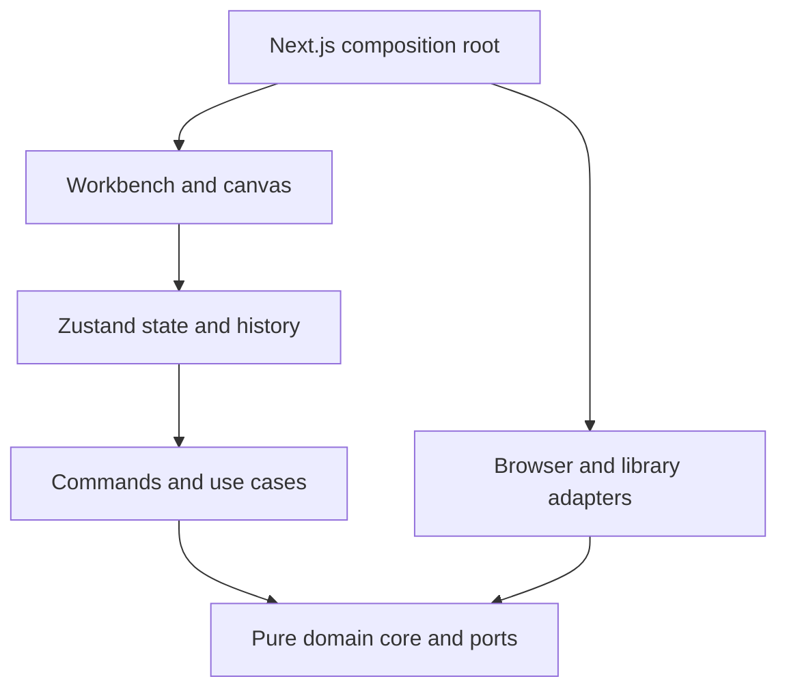

# CASEMODEL architecture

Status: architecture baseline for review; no application implementation.
Date: 2026-11-27.
Product: a local-first web CASE workbench evolving from BPwin-style process modeling to ERwin-style data modeling.

## 1. Product decisions and boundaries

### Confirmed requirements

- Phase 1 delivers process modeling: IDEF0, Gane & Sarson DFD, and IDEF3 process flow descriptions.
- Every process model starts with IDEF0. DFD and IDEF3 are available through decomposition, not as independent root models.
- Users may create notation-invalid connections. The editor retains them and reports errors instead of blocking the connection gesture.
- A persistent model status bar lists violations across the entire model. A green check appears only after the current model revision has been checked and no issues remain.
- The first release targets small educational projects with up to 20 diagrams. This is the initial qualification target, not an arbitrary file-format limit.
- Phase 2 adds data modeling, logical/physical representations, SQL engineering, and process/data traceability.
- Functional parity with BPwin and ERwin is the long-term product direction. The enumerated Phase 1 requirements are the first delivery scope; unspecified legacy features need a capability inventory before they can be promised as complete.
- The application has no built-in AI, LLM calls, model server, account backend, or collaborative editing service.
- Interface labels, tooltips, dialogs, validation messages, and reports are Russian. Source identifiers, comments, engineering documentation, commits, and agent instructions are English. User-authored model content is preserved in its original language.
- Implementation follows architecture review. This document does not create framework scaffolding, executable configuration, agent skills, or deployment resources.

### Proposed clarifications to the original handover

| Topic | Proposal | Reason / decision status |
| --- | --- | --- |
| Build runtime | Use Node.js 24 LTS for the initial toolchain; pin a supported patch at bootstrap | Node.js 20 is EOL. Production remains Nginx-only. Proposed update to the handover. |
| Routing | Keep elkjs for automatic graph layout; add a deterministic fixed-position orthogonal routing strategy | ELK Layered is not a general fixed-node edge router. Exact staircase placement and manual positions need a separate strategy. Proposed refinement. |
| SVG export | Generate portable SVG primitives from a shared drawing scene; retain html-to-image for PNG | html-to-image wraps HTML in SVG foreignObject. This is different from a portable vector drawing. Proposed refinement. |
| Local persistence | Retain LocalStorage for Phase 1, behind a repository interface | Fits the selected small-model scope if quota failures and recovery are implemented. IndexedDB is a later adapter, not a hidden scope change. |
| Offline availability | Local editing needs no network after assets load; cold-start offline availability is a separate service-worker milestone | Local-first storage does not itself cache application assets. |
| Legacy file compatibility | Treat original BPwin/ERwin file import/export as a separate compatibility workstream | The specified .bpw.json is a new format, not a claim of binary compatibility. |

## 2. System structure and dependency rules

Use one repository and one statically exported Next.js application, with a modular domain core. A monorepo and independently deployed services are unnecessary for this scope.

Arrows indicate allowed source dependencies. The composition root supplies adapters to application use cases through core-defined ports. The core never imports an adapter or UI package.

| Layer | Responsibility | Dependencies and prohibitions |
| --- | --- | --- |
| `src/core/schema/` | Versioned Zod schemas and inferred domain types | Zod and internal pure modules; no browser APIs |
| `src/core/engine/` | Commands, hierarchy, boundary reconciliation, arrow networks, semantic operations | Schema and pure domain helpers |
| `src/core/validators/` | Structural, notation, hierarchy, and model-wide diagnostics | Core types only; no translated message strings |
| `src/core/layout/` | Geometry types, staircase placement, port allocation, routing contracts and geometry validation | Pure functions; external layout execution is injected |
| `src/core/generators/` | Drawing scene, SVG serialization, report plan, future SQL/CRUD generation | Pure deterministic inputs and outputs; no DOM, downloads, or jsPDF |
| `src/core/ports/` | Persistence, layout, measurement, and application boundary contracts | Core types only |
| `src/application/` | Execute use cases, schedule checks, coordinate import/export and asynchronous jobs | Core and injected ports; no React or Zustand |
| `src/store/` | Document state, editor session, derived results, zundo history | Application and core; no direct file or storage access |
| `src/adapters/` | LocalStorage, file APIs, elkjs, text measurement, html-to-image, jsPDF, worker transport | Implements core ports; never imported by core |
| `src/components/` | Russian workbench, inspectors, React Flow projection and interactions | Store, presentation helpers, domain read types |
| `src/workers/` | Layout/validation worker entry points and message transport | Core, relevant adapters; no React or document access |
| `src/i18n/` | Russian UI catalog and diagnostic formatting | No domain mutation |
| `src/app/` | Next.js entry points, static shell, client initialization and dependency wiring | Outermost composition layer |

Core code uses no React, Next.js, React Flow, DOM, Storage, Worker, network, filesystem, global clock, or random-ID APIs. The application boundary supplies IDs, timestamps, seeds, and measured text bounds. Identical domain input and command data must produce identical domain results.

React Flow nodes and edges are projections, never the persisted model. Pure import-boundary checks and strict TypeScript/ESLint rules enforce this separation. Explicit or implicit `any` and `@ts-ignore` are forbidden in maintained project code.

## 3. Planned repository organization

These are planned locations, not files created in the architecture stage.

| Path | Contents |
| --- | --- |
| `docs/ARCHITECTURE.md` | This baseline, contracts, decisions, risks, and acceptance criteria |
| `docs/decisions/` | Later ADRs for confirmed changes to this baseline |
| `docs/notation-rules/` | Rule catalog, source references, and minimal valid/invalid examples |
| `docs/parity-matrix.md` | BPwin/ERwin capability inventory and implementation status |
| `src/core/schema/common/` | IDs, metadata, references, diagnostics, geometry |
| `src/core/schema/process/` | IDEF0, DFD, IDEF3, arrows, decomposition, interfaces |
| `src/core/schema/data/` | Phase 2 namespace; no placeholder ER implementation in Phase 1 |
| `src/core/schema/traceability/` | Phase 2 typed cross-model references |
| `src/core/schema/migrations/` | Explicit version-to-version pure migrations |
| `src/application/commands/` | Editing, decomposition, import, auto-layout, document lifecycle |
| `src/components/workbench/` | Toolbar, explorer, inspector, model status bar |
| `src/components/canvas/` | Canvas adapter, custom nodes/edges, handles, frame and selection |
| `src/components/export/` | Isolated export renderer and progress UI |
| `src/adapters/persistence/` | LocalStorage project repository and recovery |
| `src/adapters/layout/` | ELK input/output mapping and execution |
| `src/adapters/export/` | PNG capture, PDF rendering, download delivery |
| `tests/unit/`, `tests/fixtures/`, `tests/e2e/` | Domain cases, versioned documents, browser workflows |
| `public/fonts/` | Bundled fonts with Cyrillic coverage and license notices |
| `.github/workflows/`, `deploy/` | Future verification, image publishing, and deployment definitions |

## 4. Canonical document model

### 4.1 Identity and ownership

A `ProjectDocument` is the portable `.bpw.json` envelope. It contains a format identifier, schema version, application version, project ID, monotonic revision, metadata, model collections, and persisted presentation data.

Phase 1 presents one process model per project. The envelope uses a collection so Phase 2 can add data models without changing every reference. Each process model owns one IDEF0 root diagram. Diagrams belong to exactly one model and have at most one decomposition parent. The decomposition hierarchy must be acyclic; the arrows inside a diagram need not be acyclic.

| Concept | Meaning and ownership |
| --- | --- |
| `ProcessModel` | Title, purpose, viewpoint, author, root diagram, model-level settings and dictionary |
| `Diagram` | Notation, ordered node references, relation references, interface bindings, frame metadata |
| `Node` | Discriminated notation-specific semantic entity; independent of coordinates |
| `Relation` | Typed IDEF0 arrow segment, DFD data flow, or IDEF3 link with explicit endpoints |
| `Endpoint` | Existing node attachment, diagram boundary attachment, or IDEF0 branch/join attachment |
| `ArrowConcept` | Dictionary identity, name and definition; can be referenced by multiple occurrences |
| `ArrowNetwork` | IDEF0 branch/join topology and segment-level concept references |
| `BoundaryBinding` | Stable correspondence between a parent activity incidence and a child interface occurrence |
| `Decomposition` | Parent activity/process/UOW reference, child diagram reference, notation and mapping policy |
| `Presentation` | Node bounds, port order/offsets, label positions, manual waypoints, page/frame configuration |
| `Diagnostic` | Stable rule ID, severity, subject references, revision, message key and parameters |

Use opaque stable IDs for references. Human-readable node numbers and ICOM codes are derived from hierarchy and explicit ordering; they are never database keys. Renumbering A2 to A3 must not sever a child diagram, tunnel, dictionary reference, or future table mapping.

IDEF0 numbering distinguishes the context diagram `A-0`, its activity `A0`, the decomposition diagram `A0`, and activities `A1` through `An`. The local box number is distinct from the full node number. A DFD/IDEF3 child retains its parent hierarchy reference but uses its own notation's local numbering; it does not acquire a fake IDEF0 context box.

### 4.2 Valid structure versus valid notation

Zod validates document shape, supported discriminators, bounded values, and types. A separate structural pass checks IDs, ownership, references, and hierarchy. Semantic validators check notation correctness.

Notation-invalid connections must remain representable and serializable. Endpoint direction and attachment side cannot be encoded as schema restrictions that prevent the user's requested permissive editing. For example, an IDEF0 relation leaving the left side is structurally representable but produces a notation error.

Structural corruption is different: a reference to a missing node, a non-finite coordinate, or a cyclic decomposition hierarchy is not accepted into the working document. Import reports such failures without replacing the current project. A structurally valid project with semantic errors can be opened, saved, undone/redone, and exported with its diagnostics.

No domain entity contains JSX, React Flow handles, callbacks, DOM nodes, arbitrary executable content, or HTML labels. Unknown future schema versions are rejected with a Russian explanation rather than silently stripped or downgraded.

### 4.3 Presentation and derived state

Persist semantic entities and user-authored presentation choices. Keep selection, drag previews, dialogs, clipboard state, hover, undo stacks, diagnostics, layout job state, computed routes, and cached drawing scenes outside the file.

Persist manual route waypoints and pinned positions as user intent. Automatically computed routes are disposable caches keyed by diagram revision, geometry input, router version, and settings. Export recomputes missing routes from a frozen document snapshot.

## 5. Editing, transactions, and history

Every committed edit is a domain command. Typical commands include create node, connect endpoints, reconnect relation, update property, move nodes, split/join arrow, set tunnel, create decomposition, reconcile interfaces, delete selection, import document, and apply auto-layout.

The command boundary validates structural preconditions, computes an immutable next document, reports affected IDs/diagrams, and returns invalidated derived results. It does not reject an edit merely because notation diagnostics become worse.

One user action is one history entry. Creating a decomposition and its boundary projections, deleting a subtree with its references, and reordering activities with code updates are atomic. During dragging, use transient visual coordinates; commit the final movement once. Group continuous text edits until blur or explicit commit.

Zundo tracks only the document slice, with a bounded history initially targeting 100 commands and a memory guard. UI state, diagnostics, route caches and save status are excluded. Undo/redo changes the document revision, invalidates derived work, and schedules persistence. History is cleared on project replacement; ordinary edits remain undoable.

Long-running operations carry project ID, model ID, input revision and job ID. Results from an outdated revision or previously opened project are discarded. Automatic route recomputation does not add history entries; an explicit auto-layout applies coordinates through one command. Cancellation and failure leave the document editable.

## 6. Process semantics

### 6.1 IDEF0

- A newly created model contains context diagram A-0 and one A0 activity. Validation reports deviations from exactly one context block and from 3-6 blocks on non-context diagrams; incomplete diagrams remain editable.
- Expected ICOM attachment semantics are input on left, control on top, output on right, mechanism on bottom. The linter reports departures, including invalid source sides. Canvas connection handles must permit these invalid attachments so the permissive editing policy is real.
- Activity order determines numbering and the default diagonal placement. Moving a block visually does not silently renumber the model.
- Decomposition creates a child interface occurrence for each applicable parent activity incidence. Each binding stores a stable parent reference, role, ordering and child occurrence ID. I1/C1/O1/M1 are generated labels, not identifiers.
- Editing parent arrows triggers reconciliation of affected descendants. Name changes propagate through shared concepts; role/order changes recompute boundary labels. Unambiguous additions/removals are atomic. Ambiguous mappings remain explicit unresolved bindings with diagnostics; user-authored child content is not silently deleted.
- Tunneling is an explicit endpoint/boundary relationship. Distinguish an arrow intentionally absent from a child's interface from a child boundary arrow intentionally absent at its parent. An ordinary internal child arrow is not automatically a tunnel. Show the appropriate parentheses at the affected end, rather than adding ellipses to labels.
- Branches and joins use explicit topology vertices. They are neither business activities nor IDEF3 junctions. A crossing is not a join. Segment-level concepts allow branches to describe subsets and joins to combine distinct concepts without falsely asserting that all labels mean the same thing.
- Feedback is legal when its endpoints satisfy the applicable ICOM rules. Routing reserves exterior channels for backward connections.
- Frame metadata is separate from graph topology: used-at, author, date, revision, lifecycle status, notes 1-10, node, title and number. Lifecycle status is not validation status. Russian captions are the default; a source-compatible English KIT template is a separate explicit template option if required.

### 6.2 DFD and hybrid decomposition

The renderer provides the requested Gane & Sarson process, external entity, data store and data-flow symbols. Attachments can use any side. Repeated representations of the same external entity/store may share a semantic dictionary identity while retaining separate occurrence IDs.

Direct external-entity/entity, entity/store, and store/store flows are retained and diagnosed. Processes with only incoming flows are black-hole warnings; only outgoing flows are miracle warnings. Stores missing a read/write counterpart are warnings, with a rule-catalog explanation rather than a claim that every read-only store is impossible.

IDEF0-to-DFD conversion is an explicit mapping, not a claim that every ICOM arrow is data. The decomposition setup proposes mappings for parent inputs/outputs; controls and mechanisms require semantic interpretation. A mechanism can suggest a data-store candidate, but a person or machine must not silently become a store. Save mapping decisions and unresolved candidates.

DFD boundary balancing compares semantic identities and declared compositions, not label text. Preserve mappings to parent interfaces so changes can be traced. Hybrid IDEF0/DFD balancing uses the accepted mapping; it cannot require all parent mechanisms and controls to appear as ordinary data flows.

### 6.3 IDEF3

Support UOW nodes, referents, precedence links, relational links, object-flow links and five junction kinds: asynchronous AND, synchronous AND, asynchronous OR, synchronous OR and XOR. Preserve context and elaboration fields separately from the displayed UOW identifier.

For the requested BPwin-like rule profile, direct flow branching/merging at a UOW is a diagnostic. Junctions specify fan-out or fan-in intent: valid fan-out has one incoming and at least two outgoing flow incidences; valid fan-in is the reverse. Incomplete junctions are saved with diagnostics.

The rule catalog explicitly defines which links participate in execution-flow degree checks. Relational associations and referent links must not accidentally count as execution branches. Duplicate incidences do not fabricate independent branches. Loops are not rejected merely because a graph is cyclic.

Object flow remains directed. The handover's phrase "double-headed" needs a reference rendering: a doubled arrowhead pointing forward must not be implemented as bidirectional flow. Confirm symbol fixtures against the selected BPwin/IDEF3 reference before implementing markers.

Referents use typed targets and report unresolved references. IDEF3 here means the requested process-flow profile; object-state transition networks and alternative decompositions are separate parity items, not silently claimed as delivered.

### 6.4 Decomposition policy

| Parent | Phase 1 child options | Interface policy |
| --- | --- | --- |
| IDEF0 activity | IDEF0, DFD, IDEF3 | ICOM inheritance for IDEF0; explicit mapping for hybrid children |
| DFD process inside the IDEF0 hierarchy | DFD | Balanced data interfaces |
| IDEF3 UOW inside the IDEF0 hierarchy | IDEF3 | Scenario/decomposition references; no fabricated ICOM ports |

The root restriction is confirmed. The recursive options above are the proposed initial policy. A parent has one active decomposition in Phase 1; the schema isolates decomposition relationships so alternate views can be added later. Changing an existing child's notation is not a cast: it needs a migration preview or a separate replacement operation.

## 7. Diagnostics and model status bar

The status scope is the entire active process model, including collapsed and unopened descendants. This is independent of the currently displayed diagram.

| State | Russian presentation | Behavior |
| --- | --- | --- |
| Checking current revision | `Проверка модели…` | No stale green check |
| One or more errors | `Ошибки: N` and violation entries | Red indicator; every issue reachable |
| Warnings only | `Предупреждения: N` and entries | Amber indicator; no unconditional green check |
| No diagnostics | `Модель корректна` | Green check tied to the validated revision |
| Validation failed | `Не удалось проверить модель` | Retry available; never report success |

The bottom bar remains visible across the workbench. It shows issue summaries and expands into a scrollable list containing every violation, with filters for severity, notation and diagram. Selecting an entry opens its diagram, selects the implicated relation/node/boundary and brings it into view. This meets the requirement to list all violations without making a single line unreadably wide.

Each rule declares an ID, scope, severity, source/profile, parameters and affected-object references. Core returns codes; the Russian catalog supplies text such as `Стрелка выходит из блока через левую грань` or `Поток соединяет два хранилища без процесса`.

Incremental checks run on affected diagrams and hierarchy neighbors after edits, followed by a whole-model check when needed. With up to 20 diagrams, correctness takes priority over elaborate incremental machinery. Full checks run after import, on explicit request and for reports. Green status requires a complete result for the current revision.

Raw Zod/library errors are mapped to Russian user messages. JSON saving is allowed with semantic errors. Image exports remain available. PDF reports record model validity and include an issue appendix when issues exist; they do not silently certify a draft as correct.

## 8. Layout and rendering

Separate node placement, port allocation, path routing, and drawing. All use diagram coordinates independent of zoom and screen pixels.

### Placement and routing pipeline

1. Resolve node bounds and measured text sizes.
2. Preserve manual positions or apply the requested automatic placement. IDEF0 defaults to a diagonal staircase; DFD/IDEF3 can use ELK Layered.
3. Allocate stable attachment IDs and ordered offsets on each side. Grow node dimensions when needed to maintain spacing. Moving nodes must not collapse parallel arrows onto one handle.
4. Route paths orthogonally around inflated node rectangles and reserved frame areas. Retain manual waypoints where valid.
5. Check axis-aligned segments, node intersections, endpoint clearances and label conflicts. Route failure is explicit; do not report a path through a block as successful.
6. Produce a shared drawing scene consumed by the editor projection and exporters.

ELK is an external strategy behind a core port. Pin its version and layout options, supply stable ordering and seed, and normalize coordinates. Do not assume `elk.fixed` will invent routes, or that the separate native libavoid integration is included in elkjs.

For exact IDEF0 placement and manual moves, the proposed pure router uses an orthogonal visibility/grid graph with obstacle inflation, bend penalties, stable tie-breaking, and exterior feedback lanes. This is the primary technical risk and must pass a focused prototype gate before canvas feature work. ELK-only behavior must not be advertised as equivalent without evidence.

No node overlap is an acceptance condition for completed automatic layouts. During manual dragging a preview may overlap; at drop the proposed policy finds a nearby non-overlapping placement or restores the prior position with feedback. Imported/manual conflicts remain diagnosable. Zero edge crossings is not promised for arbitrary graphs; intersections without an explicit join do not change semantics.

The canvas renders only the active diagram with memoized custom nodes/edges, stable props and atomic store selectors. Handles refresh when node dimensions or attachment sets change. Invalid links are highlighted without altering the underlying relation kind. The KIT frame is a page overlay included in bounds/export, not a selectable business node.

## 9. Workbench and localization

Desktop layout: 48 px toolbar, collapsible 260 px explorer, flexible canvas, 280 px contextual inspector, and an additional persistent bottom model status bar. The status bar reduces canvas height rather than overlapping graph content.

The toolbar groups project/file operations, undo/redo, notation-appropriate insertion, decomposition, layout, frame visibility, validation and export. The explorer shows model hierarchy and issue badges. The inspector edits the selected node/relation/diagram with notation-specific fields and dictionary references.

Use the specified palette: canvas `#F8FAFC`, panels `#FFFFFF`, borders `#E2E8F0`, accent `#2563EB`. Bundle Inter with Cyrillic coverage; use 13 px as the initial UI text size and monospace for technical codes. Keyboard focus, accessible names and severity icons must not depend on color alone.

Narrow screens collapse side panels into drawers; the status bar remains reachable. Desktop keyboard/mouse editing is the initial qualification target. Full touch/CAD parity is a separate acceptance decision, not implied by a responsive shell.

Use Russian navigation and diagnostics. IDEF0, DFD, IDEF3, ICOM codes, A-0 identifiers and standard symbols remain notation tokens. Store lifecycle enums in English and display Russian labels. User text must survive multiline editing, serialization, export and round trips unchanged.

## 10. Persistence, import, and recovery

The `ProjectRepository` contract handles list metadata, load, save with expected revision, recovery and removal. Phase 1 implements it with LocalStorage. It is injected rather than reached from node components.

Autosave follows committed commands with a short debounce, initially 500 ms; lifecycle events are a best-effort additional flush. The UI distinguishes changed, saving, saved and save-failed states. Never mark a revision saved before storage confirms success.

Use two versioned document slots and a small active-slot pointer per project. Write the inactive slot first, then switch the pointer. Retain the last valid slot for recovery. Budget for both serialized copies and other same-origin data. A failed write preserves the prior valid document and the current in-memory document. Explain the failure in Russian and keep file export available.

LocalStorage has a small per-origin quota and synchronous operations. Measure serialized sizes and save duration on the qualification fixture; do not infer capacity from diagram count alone. A 20-diagram project with unusually large descriptions may still exceed quota. If the selected fixture cannot fit with recovery headroom, move the repository adapter to IndexedDB as an explicit architecture revision.

Use one writer tab per project where browser coordination allows it. A second tab opens read-only until ownership transfers. Revision checks and storage notifications detect external changes; never silently overwrite a newer saved revision. File export remains the portable backup boundary.

Import sequence: bounded file read, JSON parse, envelope/version validation, supported migrations on a copy, structural validation, semantic diagnostics, then an explicit project-open commit. The prior working project is preserved on failure. Future versions and unsupported legacy binary formats receive clear explanations.

Store no project data on the server. Bundle runtime assets and fonts locally. A static `/editor/` entry reads project and diagram selection on the client; do not rely on runtime-generated Next.js routes for local IDs. No API routes, Server Actions or runtime server components are part of the editor.

## 11. Exports and reporting

All exports operate on one frozen revision, independent of later editing. Render the full diagram, not the current viewport. Include frame and label extents and wait for fonts, measurement and layout completion.

| Format | Architecture | Acceptance |
| --- | --- | --- |
| `.bpw.json` | Versioned canonical document serializer | Round trip preserves IDs, topology, hierarchy, bindings, tunnels and manual layout; semantic errors survive |
| PNG | Isolated export renderer plus html-to-image, pixel ratio 2 | Entire diagram, no grid/handles/toolbars/selection, readable Cyrillic and unclipped labels |
| SVG | Proposed pure scene-to-SVG generator | Shapes, paths, text and markers; no foreignObject dependency, external URLs or editor chrome |
| PDF | Pure report plan plus jsPDF adapter | Landscape A4, Cyrillic fonts, stable ordering, pagination and usable margins |

The proposed drawing scene consists of rectangles, paths, text runs, markers and frame fields with measured coordinates. SVG serialization escapes user text. The same measurements and symbols are reused across display and exports to limit visual drift.

PDF order: paginated hierarchical node tree, A-0, depth-first traversal of descendants in explicit node order, arrow dictionary, and diagnostics appendix when required. The dictionary deduplicates by semantic identity and lists occurrences, inherited ICOM references and tunnel notes. Same-named but distinct concepts are not silently merged.

The PDF adapter renders pages sequentially with progress and cancellation, releasing image/canvas resources between pages. Diagram pages may use high-resolution images for the first implementation; PDF vector diagrams are not promised by that choice. Text tables use a bundled font supporting Cyrillic. Long tables repeat headers; large diagrams receive a legibility warning rather than silent clipping.

Export errors must not mutate the document, change selection or erase the user's viewport. Browser download delivery and DOM capture remain outside the core.

## 12. Phase 2: data modeling and traceability

Extend the envelope with a separate `DataModel` aggregate; do not turn database entities into process nodes with optional fields. Share identity, geometry, diagnostics, history, persistence and drawing infrastructure, while keeping domain rules separate.

Logical entities/attributes and physical tables/columns are linked models with explicit mappings. Switching views selects a representation, not a destructive conversion. DBMS-specific physical types, PK/FK constraints, nullability and indexes belong to a physical target configuration.

IDEF1X and Crow's Foot are rendering/validation profiles over the data domain, with notation-specific distinctions preserved. SQL generation uses dialect adapters for PostgreSQL, MySQL and SQL Server. Reverse engineering parses input text into an intermediate representation, reports unsupported constructs, and previews a model update. It never executes uploaded SQL or connects to a database in the browser MVP.

Traceability uses stable typed references between process activities/flows/stores and data entities/tables. CRUD operations must be explicit annotations or accepted mapping suggestions: an arrow direction alone cannot distinguish create, update and delete. Generate the matrix from those annotations and report incomplete mappings.

Phase 1 only reserves these boundaries. ER editors, SQL parsers and CRUD screens are not shipped as nonfunctional placeholders.

## 13. Agent harness and production architecture

### Instruction layout, to be created during bootstrap

The root `AGENTS.md` will define architecture boundaries, Russian UI/English engineering text, strict typing, scope rules and verification commands. `CLAUDE.md` will reference `@AGENTS.md`. `.claude/skills` is intended to be a relative symlink to `../.agents/skills`; Windows checkout/symlink support must be verified rather than assumed.

| Skill location | Planned skills |
| --- | --- |
| `.agents/skills/` | role-architect, role-developer, role-ui-designer, role-qa-engineer, devops-cicd |
| `src/core/.agents/skills/` | notation-idef0, notation-dfd, notation-idef3, graph-layout-routing |
| `src/components/.agents/skills/` | react-flow-canvas, export-and-reporting |

The root instructions explicitly index the nested skill locations; a symlink to root skills alone does not expose all scoped instructions. Nested `AGENTS.md` files can route work to the relevant domain instructions. Skills remain canonical in one location, without duplicated copies. This layout enables Codex/Claude workflows but does not require spawning agents for every task.

### Build and release

- Next.js App Router, React 19, strict TypeScript, Tailwind, Lucide, React Flow, Zustand/zundo, Zod, elkjs, html-to-image and jsPDF remain the selected stack. Pin compatible versions and commit the lockfile at bootstrap.
- Static output is served from `/out` by one Nginx Alpine container. Node.js is used only in development/CI/build stages.
- Pull requests and main run typecheck, lint, unit tests, production static build and browser E2E. The handover's deployment workflow must include the required E2E gate, not merely list it in AGENTS.md.
- Publish the tested image to GHCR with an immutable commit tag/digest; `latest` may be an alias. Verify the image/asset build that will actually be deployed.
- Deploy serially over SSH, retain the prior digest, pull the new image, update Compose, perform a static health check, and roll back on failure. Do not prune the rollback image before health verification.
- Use the specified 128 MB container memory and 256 MB memory-plus-swap limits as deployment settings, then measure actual use. Do not promise a fixed 15-20 MB RSS. The 2 GB host swap is a provisioning task, not an application build step.
- Keep host configuration in `/opt/bpwin/.env`, outside Git. Static application bundles contain no secrets. GHCR access and SSH credentials are deployment-only credentials.
- Cache hashed assets immutably; HTML is revalidated. Enable gzip. Long-running tabs may retain an older application/schema version, so storage ownership and migrations must account for that.
- TLS termination and domain/DNS setup are deployment prerequisites to select later. They do not introduce a model-data backend.

## 14. Verification and delivery sequence

The architecture stage is documentation only. The repository currently has no package manifest or executable tests, so implementation checks cannot run yet.

### Future mandatory commands

`npm run typecheck`, `npm run lint`, `npm run test:unit`, `npm run test:e2e`, and `npm run build`.

Unit/integration and browser-test effort should broadly follow the requested 70/30 balance; this is not a substitute for scenario coverage or a claim of a 70% line-coverage threshold.

| Stage | Deliverable | Exit criteria |
| --- | --- | --- |
| 0. Architecture | This document and resolved product decisions | Scope, permissive diagnostics, root policy and target scale recorded |
| 1. Bootstrap | Instructions, skills, dependencies, static shell and CI definitions | Strict typing, import boundaries, static build and minimal browser smoke pass |
| 2. Domain and persistence | Schemas, migrations, command engine, history and recovery | Round trips, semantic-invalid documents, recovery failures and atomic undo tested |
| 3. IDEF0 vertical slice | Context, blocks/arrows, decomposition, inheritance, tunnels, branches, status bar | Parent-child changes reconcile; all issues reachable; fixed-position routing gate passes |
| 4. Hybrid notations | DFD and IDEF3 descendants with mapping and validators | No independent roots; invalid relations retained and correctly diagnosed |
| 5. Output and qualification | Frame, PNG, portable SVG, PDF, scale fixtures | All diagrams export, Cyrillic renders, report ordering and dictionary correct |
| 6. Release | Tested static container and deployment/rollback process | Full verification suite and production-image smoke pass |
| 7. ERwin expansion | Data models, dialects and traceability | Dedicated Phase 2 specification and acceptance suite |

### Essential acceptance scenarios

1. Create an IDEF0 model, decompose A0, move/rename/reorder activities, and preserve stable child references.
2. Create an IDEF0 arrow with an invalid side, a DFD store-to-store flow and an invalid IDEF3 branch. All remain saved; the status bar lists all three, including issues in unopened diagrams.
3. Select a violation and navigate to its exact subject. Repair the issues; green appears only after a full check of the current revision.
4. Decompose with ICOM inheritance; change the parent, add a branch and toggle each tunnel direction. Child bindings remain explainable, and one undo restores the complete prior hierarchy.
5. Create DFD/IDEF3 only through the IDEF0 hierarchy, then recursively decompose supported child elements. Hybrid mappings retain provenance.
6. Import malformed JSON, an unsupported future version and a structurally corrupt file without losing the current document. Open a structurally valid file with notation errors successfully.
7. Simulate a quota error and interruption between storage writes. Recover the previous valid revision; keep unsaved work exportable. A second tab cannot silently overwrite it.
8. Verify automatic routes are orthogonal, avoid node interiors and preserve distinct attachment positions; stale asynchronous results cannot overwrite a newer revision.
9. Export every diagram from a frozen snapshot, including offscreen nodes and the frame. Inspect PNG bounds, portable SVG elements and Cyrillic PDF pages, tree and dictionary.
10. Run a representative 20-diagram fixture, including one denser DFD/IDEF3 diagram, on the supported browser baseline. Measure storage headroom, history memory, opening, editing, validation and export before setting published performance claims.
11. E2E uses stable `data-testid` selectors, fails on uncaught `pageerror`, and tests the production static output as well as relevant editor interactions.

## 15. Remaining decisions and risks

These do not block an architecture document. They must be settled at the indicated implementation gate.

| Item | Baseline / next decision | Gate |
| --- | --- | --- |
| Fixed-position routing | Proposed independent pure router plus ELK placement | Before canvas implementation |
| Portable SVG | Proposed scene-based generator, PNG still html-to-image | Before export implementation |
| BPwin/ERwin parity | Inventory concrete workflows and legacy versions; distinguish implemented, planned and excluded capabilities | Before claiming full replacement |
| Legacy file import | No binary compatibility implied by `.bpw.json`; select formats and obtain representative fixtures | Separate compatibility milestone |
| Notation authority | Trace every rule to the selected source or explicitly identify it as a BPwin/product profile rule | Before validator acceptance |
| Russian standard frame | Confirm the exact R 50.1.028-2001/KIT template and captions; avoid an unsupported blanket GOST-conformance claim | Before frame acceptance |
| IDEF3 symbols | Confirm object-flow arrowhead and referent fixtures; do not confuse direction and marker style | Before renderer acceptance |
| Browser support | Proposed desktop Chromium/Firefox baseline; qualify WebKit separately, especially exports | At bootstrap/test planning |
| Project size | 20 diagrams is confirmed; per-diagram density/text sizes need a realistic fixture | Before performance qualification |
| Offline reload | Service worker not included in the initial local-first promise | If offline cold-start is required |
| Logical/physical parity | Phase 2 needs concrete dialect/version and reverse-engineering coverage | Before Phase 2 implementation |

## 16. Primary references checked for architecture

Accessed 2026-11-27. These support specific constraints, not blanket certification of all notation rules.

- [Next.js static export](https://nextjs.org/docs/app/guides/static-exports): build-time static output and restrictions on server-dependent features.
- [Node.js release status](https://nodejs.org/en/about/previous-releases): supported runtime selection; Node 20 is EOL and Node 24 is listed as LTS.
- [MDN storage quotas](https://developer.mozilla.org/en-US/docs/Web/API/Storage_API/Storage_quotas_and_eviction_criteria): LocalStorage quota and error handling constraints.
- [ELK Layered](https://eclipse.dev/elk/reference/algorithms/org-eclipse-elk-layered.html): graph layout and orthogonal routing options.
- [ELK fixed-node routing discussion](https://eclipse.dev/elk/blog/posts/2022/22-11-17-libavoid.html): distinction between layered layout and a separate fixed-position router.
- [elkjs documentation](https://github.com/kieler/elkjs): algorithm availability, asynchronous execution and worker integration.
- [html-to-image documentation](https://github.com/bubkoo/html-to-image): DOM cloning, foreignObject-based SVG and capture limitations.
- [NIST FIPS 183](https://nvlpubs.nist.gov/nistpubs/Legacy/FIPS/fipspub183.pdf): IDEF0 context, hierarchy and numbering reference.
- [IDEF3 method overview](https://www.idef.com/idef3-process-description-capture-method/): process-flow versus object-state descriptions and decomposition scope.

The detailed Gane & Sarson, R 50.1.028-2001 and BPwin-specific rule catalogs remain to be verified against their chosen primary references during domain specification. They are not presented here as independently certified standards compliance.
